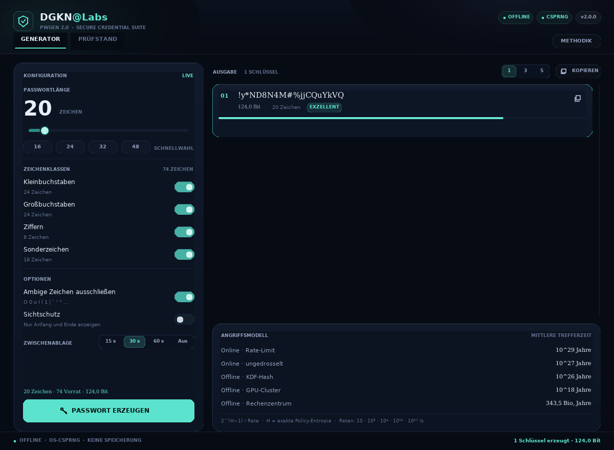
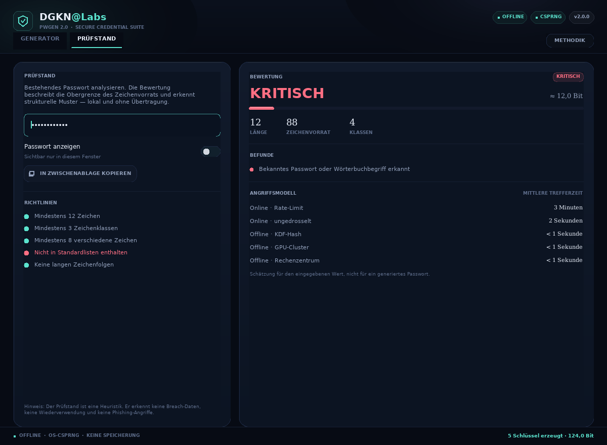

# PWGen · DGKN@Labs

Offline-Passwortgenerator mit exakter Entropieanzeige, transparentem
Angreifermodell und integriertem Prüfstand. Python 3.10+, Tkinter,
**keine Laufzeitabhängigkeiten**, kein Netzwerkzugriff.





## Projektgeschichte

Dieses Projekt ist historisch gewachsen. Der ursprüngliche Passwortgenerator
entstand vor einiger Zeit mit sehr wenig Einsatz von KI-Unterstützung; der
Code war entsprechend pragmatisch und als einzelne GUI-Datei aufgebaut. Für
Version 2.0 wurde die Codebasis grundlegend überarbeitet: klarer Krypto-Kern,
testbare Oberfläche, reproduzierbarer Windows-Build und eine Dokumentation,
die auch die Grenzen offen benennt. Die ursprüngliche Idee und der
Funktionsumfang bleiben erhalten — die Umsetzung wurde an den heutigen Stand
angepasst.

## Sicherheitsmodell

- **Zufall:** `secrets.SystemRandom` — der Kryptografie-Zufallsgenerator des
  Betriebssystems, nicht `random`.
- **Klassenpflicht:** Jede aktive Zeichenklasse kommt garantiert mindestens
  einmal vor. Die Auswahl verwerfen-und-neu-ziehen erhält eine Gleichverteilung
  über genau die Menge der zulässigen Passwörter.
- **Exakte Entropie:** Angezeigt wird `log2` des tatsächlich erzeugbaren
  Schlüsselraums (Inklusion-Exklusion über die Zeichenklassen), nicht die
  optimistische Näherung `Länge × log2(Alphabet)`.
- **Transparentes Angreifermodell:** Mittlere Trefferzeit `2^(H−1) / Rate`.
  Die Raten (10/s bis 10¹⁵/s) stehen in der Oberfläche und in der Methodik.
- **Keine Spuren:** Der Laufzeitcode öffnet keine Dateien, protokolliert keine
  Passwörter und importiert keine Netzwerkmodule. Das prüft
  `tests/test_static.py` per AST-Analyse.
- **Zwischenablage:** Löscht den kopierten Wert nach 15/30/60 Sekunden — aber
  nur, wenn noch genau dieser Wert enthalten ist. Beim Schließen wird
  ebenfalls aufgeräumt.
- **Sichtschutz:** Passwörter lassen sich auf Anfang und Ende maskieren.

**Grenzen, offen benannt:** Python kann Strings nicht zuverlässig
überschreiben; Speicher-Hygiene ist damit eine Eigenschaft der Laufzeit, keine
Zusage dieses Programms. Der Prüfstand ist eine Heuristik und erkennt keine
Breach-Daten, Wiederverwendung oder Phishing. Die Windows-Binärdatei ist nicht
signiert. „Militärisch“ ist kein Sicherheitsmerkmal — die Stärke kommt aus
CSPRNG, Policy und Entropie, nicht aus einem Label.

## Funktionen

- Länge 8–128 in der Oberfläche (Kern: 8–256), Schnellwahl 16/24/32/48
- Vier Zeichenklassen einzeln schaltbar, ambige Zeichen ausschließbar
- 1, 3 oder 5 Passwörter pro Durchlauf, einzeln oder gesammelt kopierbar
- Exakte Entropie, Bewertung und fünf Angreifermodelle pro Ausgabe
- Prüfstand mit Zeichenvorrat, Mustererkennung (Sequenzen, Wiederholungen,
  Tastaturreihen, Jahreszahlen, Standardpasswörter) und Richtlinien-Check
- Vollständig per Tastatur bedienbar: `Strg+G`, `Strg+C`,
  `Strg+Umschalt+C`, `Strg+H`, `F1`
- Glass-Oberfläche ohne externe UI-Abhängigkeiten; dunkle Windows-Titelleiste

## Starten

```bash
python pwgen_gui.py
```

Voraussetzungen: Python 3.10+ mit Tkinter. Unter Debian/Ubuntu:
`sudo apt install python3-tk`. Es sind keine `pip`-Pakete nötig.

### Windows-Binary

Im Ordner `Release/` liegt `PWGen-DGKN-Labs.exe` (Single-File, ohne Installer).
Die Datei ist nicht signiert; Windows SmartScreen kann beim ersten Start
warnen. Prüfsumme: siehe `Release/SHA256SUMS.txt`. Die GitHub-Release-Seite
enthält einen separat in der CI gebauten Windows-Build; für diesen gilt die
dort beigefügte `SHA256SUMS.txt`.

## Tests

```bash
python -m unittest discover -s tests -v   # Kern, UI-Smoke, Static Checks
python pwgen_gui.py --self-test           # Exitcode 0 = Kern in Ordnung
python pwgen_gui.py --smoke-ui            # Oberfläche aufbauen und beenden
```

Headless unter Linux: `xvfb-run -a python -m unittest discover -s tests -v`.
Die UI-Tests überspringen sich automatisch, wenn kein Display verfügbar ist.

## Windows-Build

```powershell
powershell -ExecutionPolicy Bypass -File scripts/build_windows.ps1
```

Ergebnis: `Release/PWGen-DGKN-Labs.exe` plus `Release/SHA256SUMS.txt`.
Der Build nutzt PyInstaller (nur Build-Zeit-Abhängigkeit) und das Icon aus
`assets/`. Ein Tag `v2.0.0` löst zusätzlich
`.github/workflows/release.yml` aus, das die EXE baut und an das
GitHub-Release anhängt.

## Architektur

| Datei | Zweck |
| --- | --- |
| `dgknlabs/core.py` | Policy, CSPRNG-Erzeugung, exakte Entropie, Angreifermodelle, Audit |
| `dgknlabs/wordlist.py` | Kleine kuratierte Liste häufiger Passwörter (Mustererkennung) |
| `dgknlabs/theme.py` | Design-Tokens, Farbmischung, Schriftauswahl |
| `dgknlabs/widgets.py` | Canvas-Widget-Kit: Glass-Panels, Buttons, Slider, Toggles |
| `dgknlabs/app.py` | Fenster, Layout, Interaktion, Zwischenablage-Wächter, Methodik |
| `pwgen_gui.py` | Einstiegspunkt (Abwärtskompatibilität) |
| `pwgen.spec`, `packaging/` | PyInstaller-Recipe und Windows-Versionsressource |
| `tests/` | Kern-Tests, GUI-Smoke-Tests, statische Garantien |

Der Krypto-Kern importiert kein Tkinter und ist dadurch ohne Display prüfbar.

## Lizenz

MIT · © Dogukan S. · DGKN@Labs
